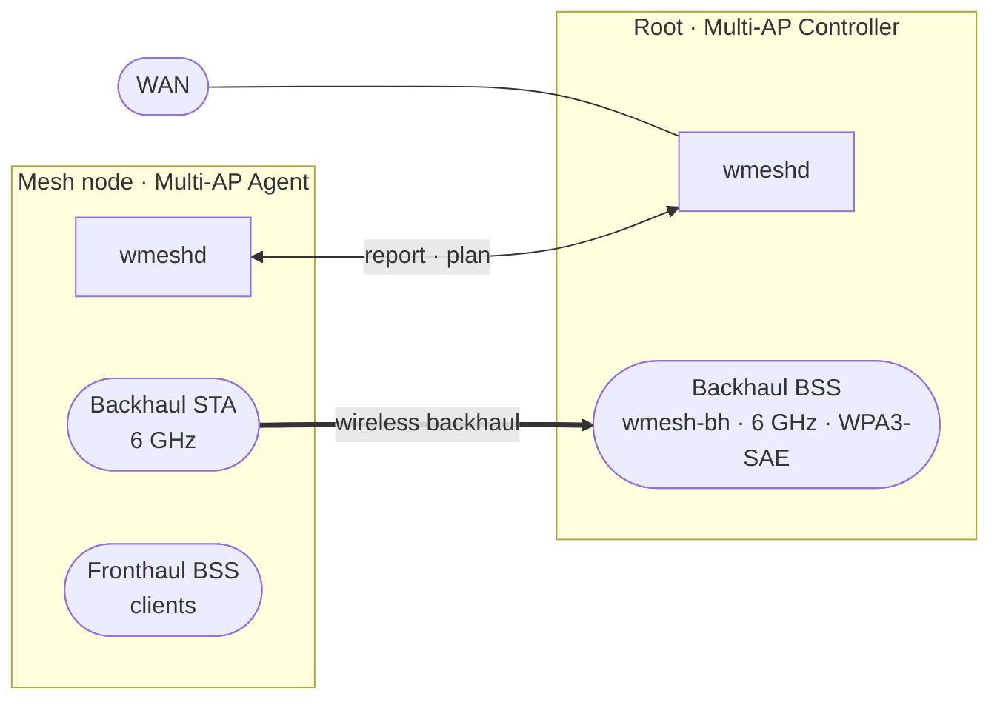

# mesh — WantasticMesh

A tiny mesh control plane for Qualcomm **T2** routers (QSDK, IPQ9574). One small
daemon (`wmeshd`) lets the units discover each other, form their **own** WPA3
6 GHz wireless backhaul, report real radio/link/GPS telemetry, and self‑heal —
**without touching your existing AP configuration.**

> **Safe by design.** The installer and daemon are *additive only*: they never
> edit `/etc/config/wireless`, never run `wifi`, never reboot. The wireless
> backhaul is a **runtime** interface (gone on stop/reboot). Your production
> (PMTP) APs are left byte‑for‑byte unchanged — the installer proves it by
> comparing the `wireless` config checksum before and after.



One node runs as **root** (controller); the others run as **leaves** (agents)
that form a backhaul STA to the root's `wmesh-bh` AP. The backhaul key is derived
from a single shared network key — no onboarding, DPP or WPS.

---

## Requirements

- **Device:** Qualcomm T2 (IPQ9574), OpenWrt/QSDK with **procd** + **UCI**, `aarch64`/**musl**, `root` access.
- **Radio:** a 6 GHz radio for the backhaul (other radios stay production APs).
- **Runtime libs:** `libnl-3`, `libnl-genl-3`, and a running `hostapd` control socket (all on stock T2 firmware).
- **To run a network:** one shared 32-byte key (64 hex) on every node, one **root** (controller) and the rest **leaves** (agents), and the root's `wmesh-bh` AP stood up once.
- **GPS (optional):** the board's GPS + its vendor daemon's fix file.

Full details, diagrams and test results: **[docs/DOCUMENTATION.md](docs/DOCUMENTATION.md)**.

## Install

On each T2, one line (the installer is additive — it prints the `wireless`
checksum before/after and aborts if they differ):

```sh
curl -fsSL https://raw.githubusercontent.com/kmoz000/mesh/main/install.sh | sh
```

No `curl`? Most T2 firmware has `wget`:

```sh
wget -qO- https://raw.githubusercontent.com/kmoz000/mesh/main/install.sh | sh
```

It downloads `/usr/sbin/wmeshd`, a procd service, and a default **disabled**
config. (Offline / from a clone: `sh install/install.sh`. Many nodes at once:
see *Fleet deploy* below.)

## Configure

Put the 32‑byte network key (64 hex chars, same on every node) and set the role:

```sh
printf '%s' '<64-hex-network-key>' > /etc/wmeshd/net.key && chmod 600 /etc/wmeshd/net.key

# --- a LEAF (relay) ---
uci set wmesh.global.role='relay'
uci set wmesh.global.net='<16-hex-network-id>'
uci set wmesh.global.controller_id='<32-hex-root-node-id>'
uci set wmesh.global.controller_addr='<root-ip>'        # optional, for routed backhauls
uci set wmesh.global.backhaul_ssid='wmesh-bh'           # enables the wireless backhaul
uci set wmesh.global.backhaul_radio='wifi2'             # the 6 GHz radio
uci set wmesh.global.backhaul_bssid='<root-AP-bssid>'   # optional lock
uci set wmesh.global.backhaul_freq='6595'               # optional (ch 129)
uci set wmesh.global.gps='1'                            # optional GPS distance sync

# --- the ROOT (controller) ---
uci set wmesh.global.role='root'
uci set wmesh.global.net='<16-hex-network-id>'

# then, on every node:
uci set wmesh.global.enabled='1'
uci commit wmesh
/etc/init.d/wmeshd start
```

## Verify

```sh
# on the root:
cat /tmp/wmesh-state.txt         # nodes, radios, measured links (RSSI), GPS pos/distance

# on a leaf:
iw dev wmbhsta0 link             # shows "Connected to <root AP>  signal -44 dBm"
```

## Uninstall

```sh
sh install/uninstall.sh          # stops the daemon, removes the runtime backhaul + service
```

Your `/etc/config/wireless` is never touched; the uninstaller confirms the
checksum is unchanged.

---

## Root AP (once per network)

The root's `wmesh-bh` backhaul AP is created as an additive hostapd BSS on the
6 GHz radio (WPA3‑SAE, bridged to `br-lan`). It is set up once per network and is
not part of the per‑node installer. See
[docs/DOCUMENTATION.md](docs/DOCUMENTATION.md).

## Fleet deploy (from your laptop)

```sh
./install/deploy.sh root@10.0.0.11 root@10.0.0.12 ...
```

For older T2 firmware that needs legacy SSH algorithms, set `SSH`/`SCP` (and
`SSHPASS`) first — see the header of `install/deploy.sh`.

## Build from source

A prebuilt `aarch64/musl` binary ships in `install/bin/wmeshd-aarch64`. To rebuild
you need the device's vendor libraries in `vendor-sysroot/` (pulled from a T2;
not redistributable, so not in this repo) plus `zig` on `PATH`:

```sh
tools/build-cgo.sh install/bin/wmeshd-aarch64
```

The pure‑Go parts build and test anywhere with `go test ./...`.

## How it works

- **Backhaul** — the leaf creates a STA vdev at runtime (`NL80211_CMD_NEW_INTERFACE`)
  and joins the root's `wmesh-bh` AP with a key both sides derive from the network
  key. No vendor tooling, no config edits.
- **Telemetry** — radios and links come from standard nl80211; each measured link
  carries real RSSI. GPS (optional) adds position and inter‑node distance.
- **Coordination** — the controller builds a last‑known‑good graph and runs a
  channel‑planning + self‑heal engine that respects the backhaul.

Full design, diagrams and test results: [docs/DOCUMENTATION.md](docs/DOCUMENTATION.md).

## Layout

| path | what |
|---|---|
| `cmd/wmeshd` | the daemon + CLI (`run`, `controller`, `agent`, `backhaul`, `radio`, `status`) |
| `internal/` | protocol, transport, controller, agent, coord, radio, nlwifi, hostapd, backhaul, gnss |
| `install/` | the additive installer, procd service, default config, prebuilt binary |
| `tools/` | the cross‑build (`build-cgo.sh`, `mkstubs.sh`, `zcc`) |
