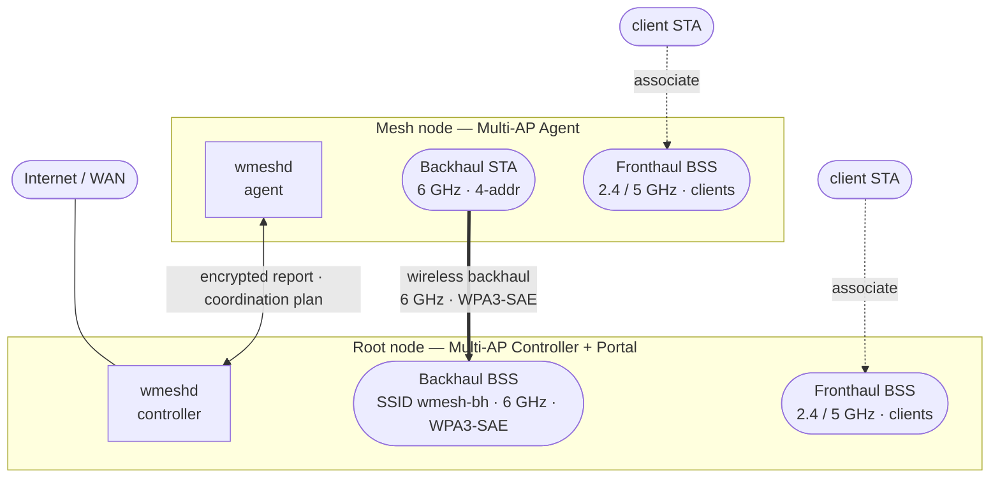
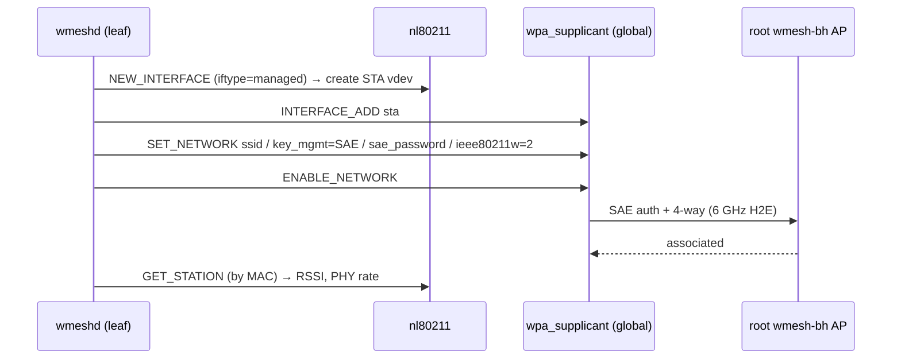
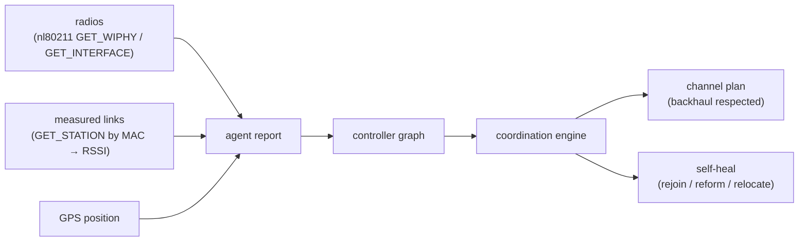
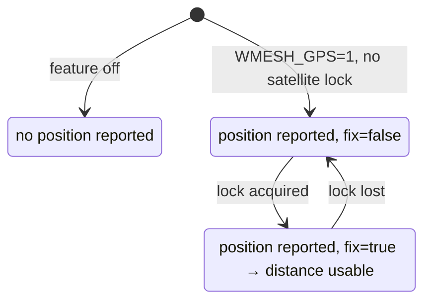
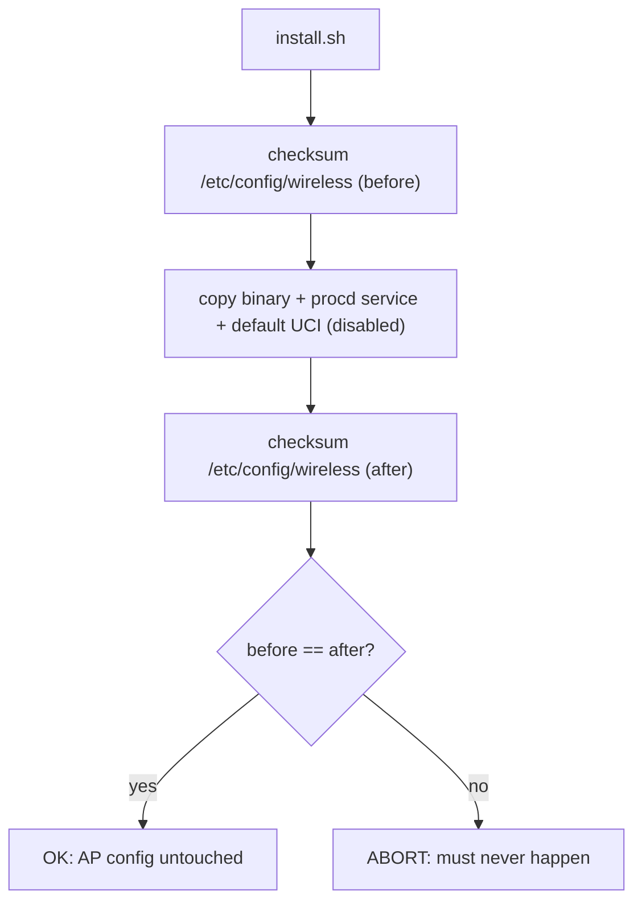

# mesh — Documentation

A compact mesh control plane for Qualcomm **T2** routers. One daemon (`wmeshd`)
lets nodes discover each other, form their own WPA3 6 GHz wireless backhaul,
report real telemetry, and self‑heal — **without touching the existing AP
configuration.**

- [Requirements](#requirements)
- [Install](#install)
- [Architecture](#architecture)
- [Backhaul formation](#backhaul-formation)
- [Telemetry & coordination](#telemetry--coordination)
- [GPS distance‑aware topology](#gps-distanceaware-topology)
- [Installer & safety](#installer--safety)
- [Test results](#test-results)

---

## Requirements

**To install**

| | requirement |
|---|---|
| Device | Qualcomm T2 (IPQ9574), OpenWrt/QSDK userland with **procd** and **UCI** |
| CPU/libc | `aarch64`, **musl** (the shipped binary is `aarch64/musl`) |
| Access | `root` on the device (daemon opens packet/netlink sockets, creates vdevs) |
| Radios | a 6 GHz radio for the backhaul (others may stay production APs) |
| Runtime libs | `libnl-3`, `libnl-genl-3`, a running `hostapd` with a control socket (both present on stock T2 firmware) |

**To run a network**

| | requirement |
|---|---|
| Network key | one shared 32‑byte key (64 hex), identical on every node, at `/etc/wmeshd/net.key` (mode 600) |
| Roles | exactly one **root** (controller); every other node a **leaf** (agent) |
| Root AP | the root hosts a 6 GHz `wmesh-bh` WPA3‑SAE BSS (stood up once per network) |
| GPS (optional) | the board's GPS; a vendor daemon publishing the fix to a text file. Enables distance‑aware features |

**To build from source** (optional — a prebuilt binary ships in `install/bin/`)

- Go toolchain, `zig` on `PATH`, and the device's vendor libraries placed in
  `vendor-sysroot/` (pulled from a T2; not redistributable). Then
  `tools/build-cgo.sh install/bin/wmeshd-aarch64`. The pure‑Go parts build and
  test anywhere: `go test ./...`.

---

## Install

### 1. Put the binary on each node

One line on the device (additive — it prints the `/etc/config/wireless` checksum
before and after and aborts if they differ):

```sh
curl -fsSL https://raw.githubusercontent.com/kmoz000/mesh/main/install.sh | sh
```

No `curl`? Most T2 firmware has `wget`:

```sh
wget -qO- https://raw.githubusercontent.com/kmoz000/mesh/main/install.sh | sh
```

Offline / from a clone: `sh install/install.sh`. To push to the whole fleet from
your laptop:

```sh
./install/deploy.sh root@NODE1 root@NODE2 ...
```

For older T2 firmware needing legacy SSH algorithms, set `SSH`/`SCP` (and
`SSHPASS`) first — see the header of `install/deploy.sh`.

### 2. Provide the network key (every node)

One shared 32‑byte key (64 hex), identical on every node:

```sh
printf '%s' '<64-hex-network-key>' > /etc/wmeshd/net.key
chmod 600 /etc/wmeshd/net.key
```

### 3. Configure the role

**Root** (one per network — the controller/portal):

```sh
uci set wmesh.global.role='root'
uci set wmesh.global.net='<16-hex-network-id>'
```

**Leaf** (every other node — an agent that forms the backhaul):

```sh
uci set wmesh.global.role='relay'
uci set wmesh.global.net='<16-hex-network-id>'
uci set wmesh.global.controller_id='<32-hex-root-node-id>'
uci set wmesh.global.controller_addr='<root-ip>'      # optional, for routed backhauls
uci set wmesh.global.backhaul_ssid='wmesh-bh'         # enables the wireless backhaul
uci set wmesh.global.backhaul_radio='wifi2'           # the 6 GHz radio
uci set wmesh.global.backhaul_bssid='<root-AP-bssid>' # optional lock
uci set wmesh.global.backhaul_freq='6595'             # optional (channel 129)
uci set wmesh.global.gps='1'                          # optional GPS distance sync
```

### 4. Enable and start (every node)

```sh
uci set wmesh.global.enabled='1'
uci commit wmesh
/etc/init.d/wmeshd start
```

### 5. Verify

```sh
cat /tmp/wmesh-state.txt      # on the root: nodes, radios, measured links, GPS/distance
iw dev wmbhsta0 link          # on a leaf: "Connected to <root AP>  signal -44 dBm"
```

### Uninstall

```sh
sh install/uninstall.sh       # stops the daemon, removes the runtime backhaul + service
```

The wireless (PMTP) AP config is never touched; the uninstaller re‑checks the
checksum to prove it. The root's `wmesh-bh` AP is stood up once per network — see
[Backhaul formation](#backhaul-formation).

---

## Architecture

The topology follows the Wi-Fi Alliance **Multi-AP (EasyMesh)** model wmesh
replaces: one **Controller** at the root (also the network **Portal** to the WAN),
**Agents** on the mesh nodes, a dedicated **Backhaul BSS/STA** carrying inter-node
traffic, and per-node **Fronthaul BSS** serving client stations.



Legend — thick line `==>` is the wireless **backhaul** (what the mesh forms and
heals); dotted lines are client **fronthaul** associations and the encrypted
control plane. The fronthaul BSSes are the node's existing production APs, left
untouched.

- The **report** is AES‑256‑GCM encrypted and challenge‑authenticated; it carries
  the node's radios, measured links (with RSSI), and optional GPS position.
- The **controller** keeps a last‑known‑good graph that survives silence and runs
  a channel‑planning + self‑heal engine. It computes; each agent applies only its
  own directives.
- The **backhaul key** is derived from the shared network key
  (`HMAC‑SHA256(key, "WMSH‑v0‑backhaul")`), so both ends compute the same WPA3‑SAE
  password with nothing exchanged over the air — no DPP/WPS/onboarding.

---

## Backhaul formation

The leaf forms its uplink entirely with standard Linux wireless interfaces — no
vendor tooling and no edits to the wireless config.



The STA is a **runtime** vdev: it disappears on daemon stop or reboot, so nothing
persistent is written to the radio config. Formation is asynchronous (it never
blocks the daemon's event loop) and self‑healing (re‑formed on each tick if the
link drops).

---

## Telemetry & coordination



Each measured link carries a real RSSI; the backhaul link is flagged so the
engine treats a node with a live backhaul as healthy and never retunes a
backhaul radio.

---

## GPS distance‑aware topology

Optional (`WMESH_GPS=1`). The board's GPS is read from the fix the vendor daemon
publishes (wmeshd does not take over the GPS UART). Each node reports a compact
fixed‑point position; the controller computes inter‑node distance.



Planned distance‑aware decisions: RSSI‑vs‑path‑loss sanity, nearest‑good‑backhaul
ranking, moved‑node detection, and distance‑based channel‑planning adjacency.

---

## Installer & safety



The installer and daemon are **additive only**: they never edit
`/etc/config/wireless`, never run `wifi`, never reboot. The wireless backhaul is
a runtime interface. Uninstall stops the daemon, removes the runtime vdev and the
service, and leaves the AP config untouched (it re‑checks the checksum).

---

## Test results

Measured on two T2 units (IPQ9574, kernel 5.4.213); node addresses and identifiers
are omitted.

**Wireless backhaul (end to end)**
- Leaf STA vdev created at runtime; associated to the root `wmesh-bh` AP over
  6 GHz WPA3‑SAE (CCMP + BIP), **signal −44/−45 dBm**, EHT160 4×4,
  PHY rates ≈ 730 / 3810–6435 Mbit/s.
- Confirmed from both ends (leaf `wpa_state=COMPLETED`; root station table shows
  the leaf authorized). Data path verified on an isolated subnet that can only
  traverse the RF link: **4/4 pings, 0% loss, ~5 ms**.

**Controller sees the backhaul as a measured link**
- Before: `links=0`. After: `links=1`, a `LinkBackhaul` record at **−44 dBm** on
  the 6 GHz radio, and the coordination engine emits **0 heals** (node healthy).

**Compiled daemon + installed service**
- `wmeshd backhaul form/status/down` form and tear down the link in‑process.
- Installed via procd: the service read UCI, launched the agent, and formed the
  backhaul automatically — `Connected to wmesh-bh, −45 dBm`.
- The link survives the daemon exiting and is re‑formed if it drops.

**GPS (three states)**
- Feature off → `pos none (GPS disabled)`.
- Enabled, no satellite lock (indoors) → `pos fix=false (GPS present, no lock)`.
- A real fix + inter‑node distance requires sky view; the distance math is
  unit‑tested to within 1 m on known 1 km / 1° baselines.

**Installer safety**
- `install.sh` reported identical `/etc/config/wireless` checksums before and
  after on a live unit: AP/PMTP configuration unchanged.

**Automated tests** — all packages pass (`go test ./...`): protocol codec and
fuzz, controller/agent exchange, coordination/self‑heal, GPS parse + distance,
backhaul command building.
